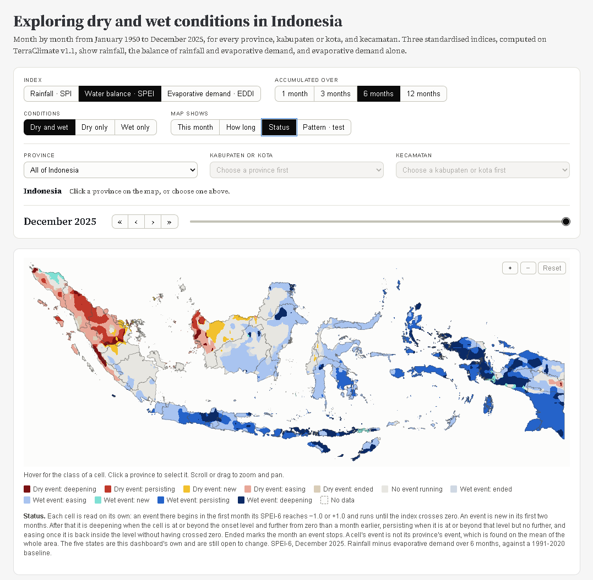

# Exploring dry and wet conditions in Indonesia

An interactive dashboard of dry and wet conditions across Indonesia, month by
month from January 1950 to December 2025, for every province, kabupaten or
kota, and kecamatan.



<!-- Figure: a screenshot of the top of the main page (controls and map), saved as docs/img/dashboard.png -->

## What it shows

Three standardised indices computed on TerraClimate, each at 1, 3, 6 and 12
months:

| Index | Measures | Dry side |
|---|---|---|
| SPI | rainfall | negative |
| SPEI | rainfall minus evaporative demand | negative |
| EDDI | evaporative demand | positive |

Pick an index, an accumulation period and a month, then click the map to open
a province, a kabupaten inside it, and a kecamatan inside that. For the place
selected, the page answers:

- **How much of it is dry or wet this month?** Share of area in each class.
- **Is it lasting, and for how long?** Events, from the month the index first
  reaches the onset level until it returns to zero.
- **Has it happened before, and how badly?** Every event on record, with its
  duration, magnitude and peak.
- **What did El Nino and La Nina go with here?** The place's index by calendar
  month in each phase, and episode by episode.

The map has three more modes besides this month's class: how long the event
in each cell has run, its status (new, deepening, persisting, easing, ended),
and the space-time pattern of the last 12 months (emerging hot spot analysis).

## Read this before trusting a number

- Months before 1970, and before 1984 in parts of Sumatra and Kalimantan, are
  less reliable and are drawn washed out.
- A small unit rests on few grid cells, and border cells are shared between
  neighbours.
- An event is not the same as being dry this month.

[docs/method.md](docs/method.md) gives every definition, the inputs you need to
reproduce this with your own data, and the known limits.

## Run it

The index cubes are not in this repository. Set their paths in
`pipeline/config.py`, then:

```
python -m pipeline.step0_grid
python -m pipeline.step0_boundaries
python -m pipeline.step1_classes
python -m pipeline.step3_export
python -m pipeline.step4_hotspot
python -m pipeline.step5_enso
python -m pipeline.step6_national
python -m pipeline.step7_status
npm install
npm run build
npm run serve
```

and open http://localhost:3211. `python -m pytest tests -q` runs the tests.

`npm run deploy` publishes the built site to the `gh-pages` branch; see the
notes at the top of `tools/deploy.ps1`.

## Built with

Python for the pipeline and [Observable Framework](https://observablehq.com/framework/)
for the page. The indices were computed with
[`precip-index`](https://github.com/bennyistanto/precip-index) (SPI, SPEI) and
[`nino`](https://github.com/bennyistanto/nino) (EDDI, ENSO tables).

## Data

TerraClimate v1.1 for the monthly climate fields. Administrative boundaries
from Badan Informasi Geospasial. ENSO indices from the NOAA Climate Prediction
Center.

## Author

Developed by [Benny Istanto](https://benny.istan.to) as a casual weekend
project.

## License

See [LICENSE](LICENSE).
